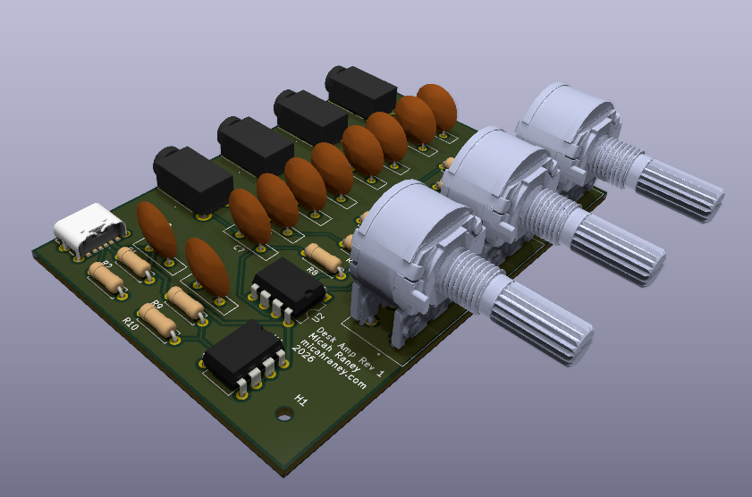
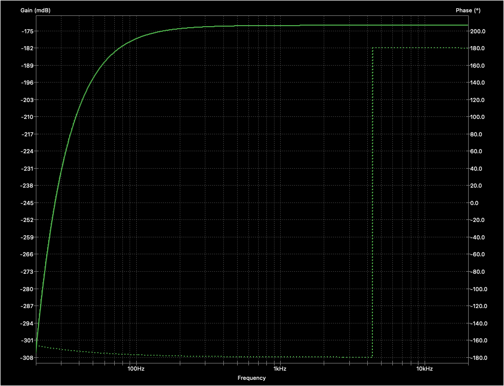

All the desktop amps are either too cheap (passive), or too expensive (too many features).

This is a project to build the simplest version of what I need:
- 3 stereo line inputs
- Ability to change the volume per-input
- 1 line output
- No EQ changes noticable to listeners (below a 'Just Noticable Difference' [threshold](https://www.sciencedirect.com/topics/engineering/just-noticeable-difference))

## Design

To keep things cheap, the design uses a single op-amp per audio channel at the cost of crosstalk between inputs.

This is modified from a number of other similar projects/tutorials. Thank you, in particular, to:
 - https://www.youtube.com/watch?v=8ejBMXT3z2g
 - https://www.youtube.com/watch?v=-AFgLTBROns
 - https://www.youtube.com/watch?v=YCIcnFuRK7w

## PCB Render
Static render of the assembled PCB.

View this project on [CADLAB.io](https://cadlab.io/project/30623) to see the current Schematic / Board renders.

## Simulated Frequency Response
Frequency response using the TI OPAx134 SPICE models, and a 10kOhm output impedance device connected, at max volume for a single channel.

- Loss is < 306mdB throught the audible
- At maximum volume, the max gain is -175 mdB
- At 20hz, we see the largest damping at -306 mdB

